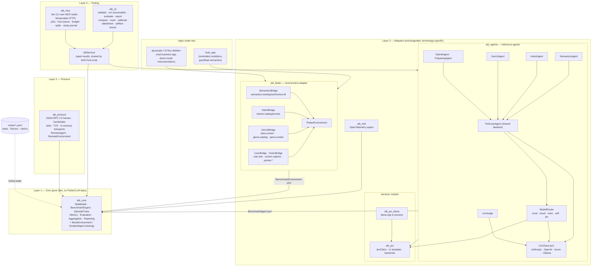
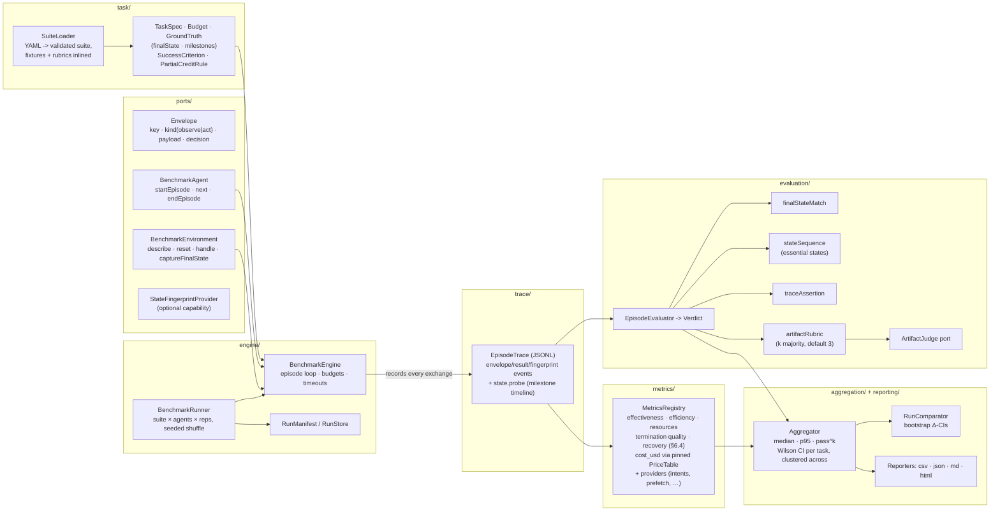
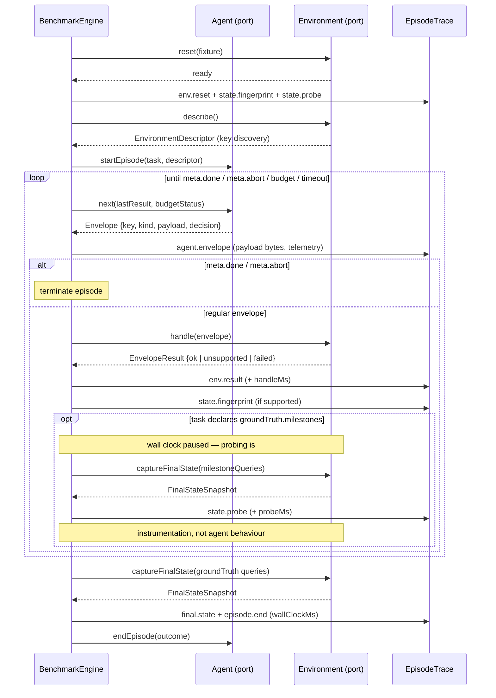
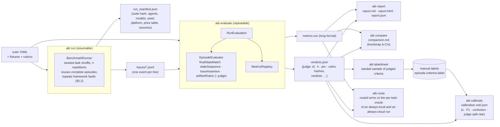
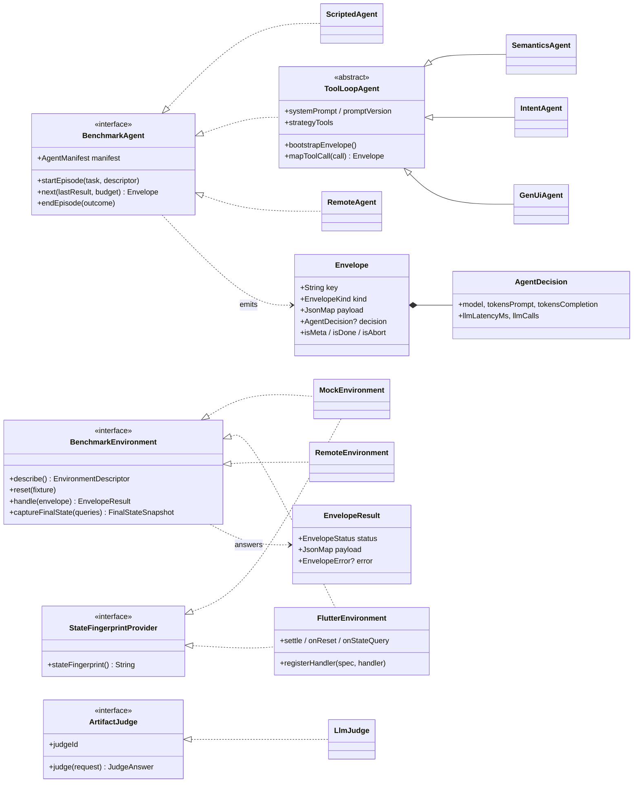
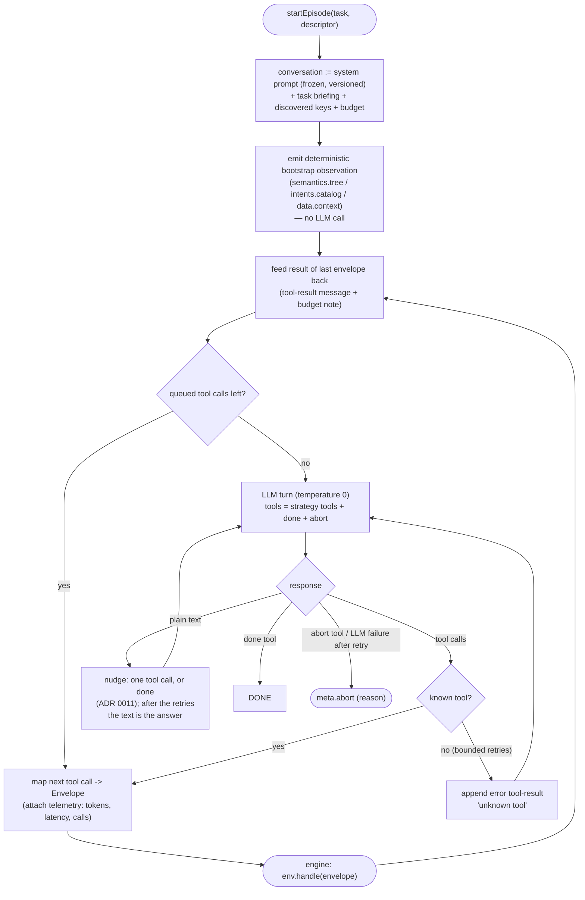
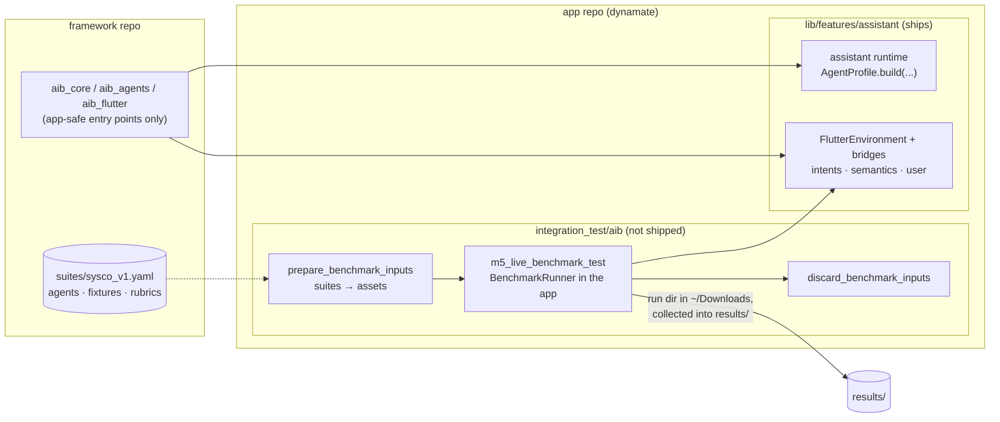
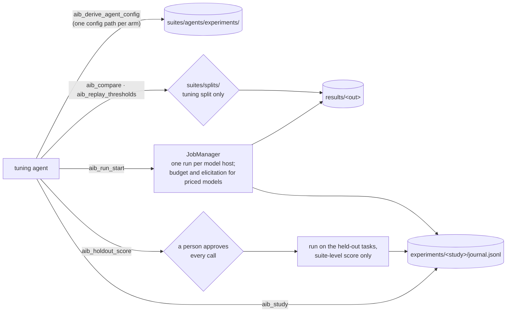

# AIB Framework — Architecture Diagrams

Status and results are in [`overview.md`](overview.md); the reasons behind
each shape are in the ADRs.

## 1. System overview — layers and packages

Hexagonal architecture (P1): every dependency points inward to the core; the
core knows neither Flutter nor LLMs nor concrete interaction patterns.

## 2. aib_core — detailed component view

The core owns no vocabulary (ADR 0002): agents and environments exchange
opaque envelopes; only `meta.*` is reserved. Execution and evaluation are
separate passes over persisted traces (P6, ADR 0003).

## 3. Episode control flow — mediated exchange

The engine is the single clock source (spec §3.3): agent and environment
never talk directly; every exchange flows through the engine and lands in
the trace — measurement happens on the wire (P4).

## 4. Run pipeline — trace-first artifacts (ADR 0003)

`aib run` produces raw traces only; verdicts, metrics and reports are a
separate, repeatable pass — new metrics apply to old runs.

## 5. Core ports — class diagram

## 6. LLM agent — tool-calling loop (aib_agents)

All strategies share this skeleton; they differ only in envelope keys, tool
set and frozen system prompt — the fairness basis of the comparison (§7).

## 7. Deployment variants — same core, different wiring

The engine cannot tell the difference between these setups; the conformance
suite proves identical verdicts/metrics in-process vs over the wire (M6 goal).

```mermaid
graph TB
    subgraph V1["In-process (todo_app M2–M4, dynamate M5)"]
        E1["BenchmarkEngine"] --- A1["ScriptedAgent /<br/>ToolLoopAgents"]
        E1 --- F1["FlutterEnvironment<br/>(widget-test harness,<br/>bounded frame pumping)"]
    end

    subgraph V2["Remote agent (Phase 6: VisionAgent)"]
        E2["BenchmarkEngine"] --- RA["RemoteAgent"]
        RA <-->|"Agent Protocol 2.0<br/>JSON-RPC 2.0 over stdio"| PY["external agent process<br/>(e.g. Python)"]
        E2 --- F2["FlutterEnvironment"]
    end

    subgraph V4["Over MCP (an agent operates the benchmark)"]
        CL["MCP client<br/>(Claude Code, a tuning agent)"] <-->|"stdio or Streamable HTTP<br/>+ bearer token"| MS["aib_mcp server"]
        MS --> SV["AibService"]
        MS -->|"runner recipes"| JOB["jobs: mock in process,<br/>flutter test subprocesses"]
    end

    subgraph V3["Remote environment (device/emulator, later)"]
        E3["BenchmarkEngine"] --- A3["Agents"]
        E3 --- RE["RemoteEnvironment"]
        RE <-->|"Environment Protocol 2.0<br/>(JSON-RPC 2.0 over TCP)"| DEV["app on device with<br/>EnvironmentProtocolServer"]
    end
```

## 8. SYSco Mobile+ — the shipped agent is the measured agent

The assistant ships inside the app and is built by the same
`AgentProfile.build` the benchmark uses. The benchmark harness lives in the
app repository (`integration_test/aib/`) and copies the suite in before a run
and out again after it, so a release build never carries a task suite.

## 9. aib_mcp — jobs, tuning and the holdout

